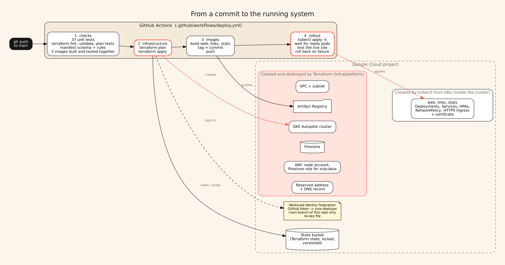

# Snip: AI 255 Project 3, Infrastructure as Code and CI/CD

The Project 2 system (a link shortener: three services on GKE with Firestore) rebuilt so that nothing is created by hand. Terraform describes the cloud resources, Kubernetes manifests describe the application, and a GitHub Actions pipeline builds, tests and deploys on every commit to `main`. The whole environment can be destroyed and rebuilt from this repository.

Shafkat Khalek Khan. AI 255 Cloud Computing Concepts, Fall 2026. The written report is `docs/REPORT.md`. Project 2 is at https://github.com/ShafkatKhan19/ai255-project2; this repository continues its Git history.



## What is in this repository

```
infra/bootstrap/   Terraform, applied once by a person: state bucket, the
                   pipeline's identity (no key file), APIs
infra/platform/    Terraform, applied by the pipeline: network, GKE Autopilot
                   cluster, image repository, Firestore, IAM, address, DNS
                   tests/plan.tftest.hcl checks the plan with a mock provider
k8s/               the application, as a Kustomize folder (kubectl apply -k k8s)
services/          web, links, stats (unchanged from Project 2, except that
                   web reports the commit it was built from)
tests/             37 unit and system tests, no cloud needed
.github/workflows/ checks.yml   everything that needs no cloud access
                   deploy.yml   checks -> terraform apply -> images -> rollout
                   destroy.yml  full teardown, then proof nothing is left
scripts/           bootstrap.ps1, demo.ps1, smoke_test.py, verify_destroyed.sh,
                   check_manifests.py, wait_ready.py, load_test.py, availability.py
evidence/          output saved from the real teardown and rebuild
```

## What happens on a commit

| Stage | What it does | Stops the pipeline if |
|---|---|---|
| checks | 37 unit tests; `terraform fmt`, `validate` and `test`; manifests rendered and checked; the three images built and tested together with the Firestore emulator | anything fails |
| infrastructure | `terraform plan`, then `apply` of exactly that plan | the plan or the apply fails |
| images | builds `web`, `links`, `stats`, tags them with the commit, pushes them | a build or push fails |
| rollout | `kubectl apply -k k8s`, waits for ready pods, runs the end-to-end test against the live address and checks the pods run this commit | pods never become ready or the test fails; then it rolls back |

Pull requests run `checks` only. They cannot get cloud credentials.

## Teardown and rebuild

```powershell
.\scripts\demo.ps1                 # teardown, then rebuild, timed, output in evidence\
.\scripts\demo.ps1 -Only teardown
.\scripts\demo.ps1 -Only rebuild
```

Or from the GitHub Actions page: run **destroy** (type `destroy` to confirm), then run **deploy**.

After a teardown the environment is parked: commits still run the checks but do not rebuild anything until **deploy** is run by hand. A cluster costs money, so it should not come back because of a typo fix.

A teardown deletes the Firestore database and the links in it.

## Setting it up in a new Google Cloud project

Needs Terraform, the gcloud CLI and the gh CLI, all signed in.

```powershell
gcloud auth application-default login
.\scripts\bootstrap.ps1 -ProjectId YOUR_PROJECT_ID -DnsZone YOUR_CLOUD_DNS_ZONE -Domain snip.example.com -Repository OWNER/REPO
git push origin main
```

`bootstrap.ps1` is the only manual step. It creates the state bucket and the identity the pipeline signs in with, and saves seven non-secret values as repository variables. The repository holds no secrets and no key files.

## Run the checks on your own machine

```powershell
py -m venv .venv
.venv\Scripts\python -m pip install -r requirements-dev.txt
.venv\Scripts\python -m pytest tests

terraform -chdir=infra\platform init -backend=false
terraform -chdir=infra\platform validate
terraform -chdir=infra\platform test

kubectl kustomize k8s > rendered.yaml
py scripts\check_manifests.py rendered.yaml

docker compose up --build -d
py scripts\smoke_test.py http://localhost:8080
```

## AI use

See Section 10 of the report.
