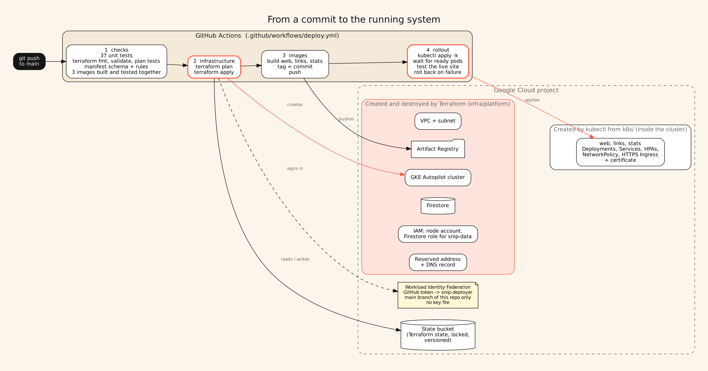

# Snip: Infrastructure as Code and CI/CD

**AI 255 Project 3.** Shafkat Khalek Khan (100818151). Prof. Yair Chaya, Fall 2026.

**Repository:** https://github.com/ShafkatKhan19/ai255-project3<br>
**Live endpoint:** https://snip.cloud.gadgetgroveny.com<br>
**Provider:** Google Cloud, region us-central1. All times in this report are UTC on 24 November 2026.

## 1. Summary

Project 2 was a link shortener made of three services (`web`, `links`, `stats`) on GKE Autopilot with Firestore. It worked, but it was built by a PowerShell script run on my PC: about twenty `gcloud` and `kubectl` commands in a fixed order. Project 3 replaces that script. The environment is described in files, and a pipeline applies them.

| Requirement | How it is met | Evidence |
|---|---|---|
| Reproduce the entire Project 2 environment from version-controlled infrastructure code | `infra/platform` (Terraform, 11 resources) creates the network, cluster, image repository, Firestore database, IAM, reserved address and DNS record. `k8s/` (Kustomize, 22 objects) creates everything inside the cluster. | The hand-built environment was deleted (Section 3). Everything running now was created by the pipeline. |
| A pipeline that builds, tests and deploys automatically on commit | `.github/workflows/deploy.yml` runs on every push to `main`. | A commit was live 3 min 32 s after the push (Section 7.1). |
| Destroyable and rebuildable from scratch | `destroy.yml` removes everything and then checks that nothing is left. Running `deploy` again rebuilds it. | Done twice. Second run: teardown 11 min 24 s, rebuild 14 min 42 s (Section 7.2). |
| Tested | 37 unit tests, 4 Terraform plan tests, manifest checks, a 13-check end-to-end test on the built containers and again on the live site (14 there: it also checks the commit). | Two bugs put in on purpose were both stopped (Section 7.3). |

## 2. What is code now



| Layer | Tool | Where | Who applies it |
|---|---|---|---|
| Pipeline identity, state bucket, APIs | Terraform | `infra/bootstrap` | A person, once |
| Network, cluster, registry, Firestore, IAM, address, DNS | Terraform | `infra/platform` | Pipeline |
| Container images | Dockerfiles | `services/*` | Pipeline |
| Deployments, Services, autoscalers, NetworkPolicy, HTTPS Ingress, certificate | Kubernetes manifests + Kustomize | `k8s/` | Pipeline |

Two things are different from Project 2 on purpose:

- **Its own network.** Project 2 used the project's `default` network. Project 3 creates a VPC and a subnet for the cluster, so a teardown removes every trace, and a leftover firewall rule or load balancer shows up as a failed delete instead of a silent charge.
- **Its own node account.** Project 2's nodes ran as the default Compute Engine service account. Project 3 creates `snip-nodes` with the minimal node role and read access to one image repository.

One small change to the application: `web` reports the commit it was built from at `/api/whoami`, so the pipeline can check that the pods serving traffic are the ones it just built.

## 3. Moving from the hand-built environment

The Project 2 environment already existed under the same names. Terraform will not take over a resource it did not create unless it is imported. The hand-built environment was deleted instead (`scripts/retire_project2.ps1`, 10:24 to 10:33, output in `evidence/retire-project2.txt`), for two reasons: the cluster had to be replaced anyway because it moves to a new network, and after the deletion every resource in the environment has been created by the pipeline and by nothing else.

The first pipeline run started at 10:34 and finished at 10:45 (11 min 33 s). It created the 11 Terraform resources, pushed three images, rolled them out and passed the live test (`evidence/first-build-jobs.txt`).

## 4. Terraform design

**Two folders, not one.** `infra/bootstrap` holds what the pipeline needs before it can run: the bucket for its state and the identity it signs in with. The pipeline cannot create these itself. Everything else is in `infra/platform`, and that is the part that is destroyed and rebuilt.

**Kubernetes objects are not in Terraform.** Terraform has a Kubernetes provider, and putting the Deployments in it would let one `terraform destroy` remove everything. I did not use it, because that provider needs the cluster to exist while it plans, which does not work in the same run that creates the cluster. The manifests are still version-controlled and applied by the pipeline with `kubectl apply -k`. The cost of this choice is in Section 6: the teardown has to delete the namespace before it runs `terraform destroy`.

**State.** The state is in a Cloud Storage bucket with versioning on. The backend locks it during a run, and the two workflows share one concurrency group, so two applies cannot overlap.

**The Firestore wait.** Google does not allow a database ID to be reused until five minutes after it was deleted, and the services use the `(default)` database. A rebuild started right after a teardown could fail there. The database resource has `depends_on` the cluster. That is not a real dependency. It only makes Terraform create the database after the cluster, which took 6 min 50 s in the rebuild. It also means a teardown deletes the database first. In the second cycle the database was deleted at 11:55:03 and created again at 12:10:14.

**Tests.** `infra/platform/tests/plan.tftest.hcl` runs `terraform test` with a mock provider, so it needs no credentials. It checks the decisions this report depends on: the cluster and database can be destroyed, the Firestore role goes to one Kubernetes service account in one namespace, and a domain with a trailing dot is rejected.

## 5. The pipeline

| Stage | Steps |
|---|---|
| checks | 37 unit tests. `terraform fmt -check`, `validate` for both folders, `terraform test`. Manifests rendered with Kustomize, checked against the Kubernetes schemas, and checked by `scripts/check_manifests.py` for the Project 2 requirements (both probes, an autoscaler with at least 2 pods, non-root, internal services stay internal). The three images are built and run together with the Firestore emulator, and the end-to-end test runs against them. |
| infrastructure | `terraform plan -out`, then `apply` of that saved plan. |
| images | Three parallel builds, tagged with the commit SHA, pushed to Artifact Registry. |
| rollout | Write the project ID and domain into `params.env`, set the three image tags, `kubectl apply -k k8s`, wait for each Deployment, run the end-to-end test against the live address, and check every pod reports this commit. On failure, `kubectl rollout undo`. |

**No keys.** The repository has no secrets. GitHub Actions gets a short-lived token from GitHub, and Google exchanges it for credentials of the `snip-deployer` service account (Workload Identity Federation). The exchange is only allowed for this repository on the `main` branch, so a pull request or a fork gets nothing.

**Tags are commits.** Images are never tagged `latest`. Any running pod can be traced to the commit that built it.

**Parking.** After a teardown, the destroy workflow leaves a marker in the state bucket. While it is there, a push runs the checks and stops. Running `deploy` by hand removes the marker and rebuilds. Without this, a one-line commit would quietly bring back a cluster that costs money.

## 6. Teardown

The order matters. The load balancers are created by GKE on behalf of the `web` Service and the Ingress, so they are not in Terraform's state. If the cluster were destroyed first, they would be orphaned: still billed, and holding the network so it could not be deleted. The destroy workflow therefore:

1. deletes the `snip` namespace and waits, which makes GKE remove the load balancers;
2. runs `terraform destroy`;
3. runs `scripts/verify_destroyed.sh`, which lists 21 kinds of resource and fails if any of Snip's remain.

What survives a teardown: the bootstrap (state bucket, pipeline identity), the enabled APIs, and the Project 1 resources that share the Google Cloud project, including the DNS zone.

## 7. Results

### 7.1 A commit deploys itself

Commit `ba05582` was pushed at 10:47:19. With no infrastructure change, `terraform apply` had nothing to do.

| Stage | Time |
|---|---|
| checks (four jobs in parallel) | 58 s |
| infrastructure (no changes) | 22 s |
| images (three in parallel) | 47 s |
| rollout and live test | 1 min 17 s |
| **Push to live, including waits between jobs** | **3 min 32 s** |

### 7.2 Full teardown and rebuild

Run twice with `scripts/demo.ps1`. The first cycle exposed two bugs in my own tooling (Section 8), so the second cycle is the clean one.

| | First cycle | Second cycle |
|---|---|---|
| Teardown, total | 11 min 01 s | 11 min 24 s |
| - delete the namespace (load balancers) | 3 min 38 s | 4 min 24 s |
| - `terraform destroy` (11 resources) | 6 min 28 s | 6 min 06 s |
| - leftover check | 17 s, wrong result (Section 8) | 17 s, 21 of 21 gone |
| Rebuild, total | 15 min 55 s | 14 min 42 s |
| - checks | 1 min 14 s | 51 s |
| - `terraform apply` (cluster alone: 7 min 38 s / 6 min 50 s) | 8 min 43 s | 7 min 56 s |
| - images | 43 s | 41 s |
| - rollout and live test over HTTP | 5 min 08 s | 5 min 06 s |
| HTTPS passing all checks, after the pipeline finished | about 5 min | 3.1 min |

Leftover check after the second teardown (`evidence/final-teardown-log.txt`):

```
gone   GKE cluster
gone   Firestore database
gone   image repository
gone   network
gone   subnet
gone   reserved address
gone   DNS record
gone   node service account
gone   forwarding rules
gone   target HTTP proxies
gone   target HTTPS proxies
gone   URL maps
gone   backend services
gone   target pools
gone   health checks
gone   endpoint groups
gone   certificates
gone   firewall rules
gone   disks
gone   IAM: Firestore binding
gone   IAM: node binding
Nothing left. The environment is gone.
```

Live test after the second rebuild, over HTTPS (`evidence/final-https-smoke.txt`):

```
[PASS] web liveness /healthz returns 200  (status 200)
[PASS] web readiness /readyz returns 200  (status 200)
[PASS] page is served  (status 200)
[PASS] create a short link (web -> links -> datastore)  (status 201)
[PASS] invalid address is rejected with 422  (status 422)
[PASS] short link redirects to the original address (3 clicks)  (status 307)
[PASS] unknown link returns 404  (status 404)
[PASS] list shows the new link  (status 200)
[PASS] stats service is answering
[PASS] clicks were counted (web -> stats -> datastore)  (counted 3)
[PASS] status endpoint reports links and stats ready  ({'web': 'ok', 'links': 'ok', 'stats': 'ok', 'pod': 'web-78f9477c5c-kgbf9'})
[PASS] responses carry a request ID for tracing  (247e4842ad7e)
[PASS] web pods answering  (web-78f9477c5c-kgbf9, web-78f9477c5c-wqfjv)

13/13 checks passed
```

After a rebuild the live test failed before it passed: 3 tries in the first cycle, 1 in the second. The pods were ready, but a new Google load balancer takes about a minute before it passes traffic. The pipeline retries for up to three minutes for that reason.

### 7.3 Two bugs put in on purpose

**A code bug** (commit `ee04a9a`: every click counted twice). The unit tests failed 27 seconds after the push (`assert {'abc1234': 6} == {'abc1234': 3}`). The infrastructure, image and rollout jobs were skipped. Nothing reached the cluster.

**A deployment bug that passes every check** (commit `09420d5`: the `links` readiness probe pointed at a path that does not exist). All checks passed, because nothing before deployment runs the real probe. In the cluster, one new `links` pod started and never became ready. Kubernetes kept the two old pods serving, because the Deployment is set to never drop below the current count. After 10 minutes the rollout was declared failed, the pipeline ran `kubectl rollout undo` on all three services, and the run ended red.

During those 14 minutes `scripts/availability.py` sent 5 requests a second to an endpoint that needs `links`:

```
requests=3929 ok=3929 failed=0 success=100.00% slowest=2259 ms
```

Afterwards the site was serving the previous commit and passed all 13 checks. Both bugs were then reverted.

## 8. What did not work

**The leftover check lied, in both directions.** After the first teardown, `verify_destroyed.sh` printed `LEFT GKE cluster` and `LEFT image repository`, and the step still passed. Neither resource was left. `gcloud` prints a warning when a filtered list is empty, the script captured warnings together with results, and it treated any text as a leftover. The step passed anyway because its output went through `tee`, and the shell reported `tee`'s exit code. So the check produced false alarms and could not have failed the run on a real leftover. Both are fixed (results only; `set -o pipefail`), tested against a stand-in `gcloud`, and the second teardown shows the corrected output.

**The demo script stopped while waiting for the certificate.** `smoke_test.py` crashed with a traceback when nothing answered on HTTPS, and PowerShell treated the traceback as a fatal error. The test now reports "no answer" as a failed check, and the script runs it through `cmd`. Because of this, the first cycle's HTTPS time was measured by a restarted wait, and the line in `evidence/demo-summary.txt` that says "2.1 minutes" counts from that restart. From the pipeline's finish it was about 5 minutes.

**The first push did not start the pipeline.** It created `main` on GitHub with every commit at once, and no run appeared. I started that run by hand. Every later push started a run by itself. I think the cause is the `paths-ignore` filter, since the last commit in that push only touched `evidence/`, but I did not confirm it.

**A failed rollout takes 10 minutes to notice.** That is Kubernetes' default progress deadline. The site stayed up for all of it, but the feedback is slow. A shorter `progressDeadlineSeconds` would fail faster. I left the default because after a rebuild Autopilot needs several minutes to add nodes, and a short deadline would fail a healthy first rollout.

**The rollback is all or nothing.** On a failure the pipeline undoes all three Deployments, including the two that rolled out fine, so the three stay on the same commit. On the very first deployment there is nothing to undo to.

**PowerShell quoting.** `gh ... --jq` with a quoted string inside lost its inner quotes on Windows. The scripts use `@tsv` instead.

## 9. Limits and what I would change

- **The bootstrap state is on my PC.** `infra/bootstrap` uses local state because the bucket it would use does not exist until it has run. It is a small set of resources applied once, and they can be imported if the file is lost, but it is not shared or locked.
- **The pipeline's identity is powerful.** It can create and delete clusters, networks and service accounts in the project, and it has DNS admin for the whole project, which includes Project 1's zone. What could be limited is limited: it can only be used from `main` of one repository, and its permission to change project IAM is restricted by a condition to two roles. A stricter setup would give it a project of its own.
- **Commits deploy with no approval step.** That is what the assignment asks for. For a real system I would add a required reviewer before `apply`.
- **A teardown deletes the data.** Correct for this project. With data worth keeping, the database would move to the bootstrap layer and have delete protection on.
- **HTTPS is not instant after a rebuild.** Google issues a new certificate each time. The pipeline tests over HTTP on the load balancer address and reports the certificate status.
- **The cluster is not private.** Nodes have public addresses, as in Project 2. Private nodes would need Cloud NAT, which adds a fixed cost.
- **Cost.** The running system is the same size as in Project 2, where I estimated about $2.55 a day. Project 3 adds a state bucket holding a few kilobytes. After a teardown only the bucket and the DNS zone remain. I did not re-measure cost for this project.

## 10. AI use

I used Claude (Anthropic) throughout this project, and I want to be clear about how much. Claude wrote the Terraform, the workflows, the Kustomize changes, the scripts, the tests and this report, working from the Project 3 description in the syllabus and from my Project 2 repository. Claude also ran everything on my PC and in my Google Cloud and GitHub accounts, at my direction: the bootstrap, the deletion of the hand-built environment, the teardowns and rebuilds, and the two experiments in Section 7.3. Claude found and fixed the problems in Section 8. Where this report says "I" about building, testing or measuring something, that work was done by Claude under my direction.

My own part was directing the work. I asked for the project to be completed from the syllabus, asked for everything that had not been run to be run for real, and approved deleting the Project 2 environment and creating the repository before either happened. Commits that contain AI-written code carry a `Co-Authored-By: Claude` line in the Git history.
